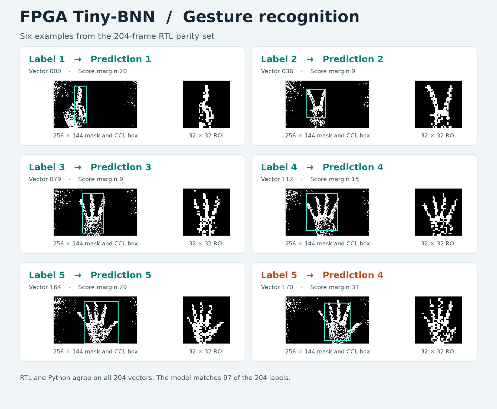
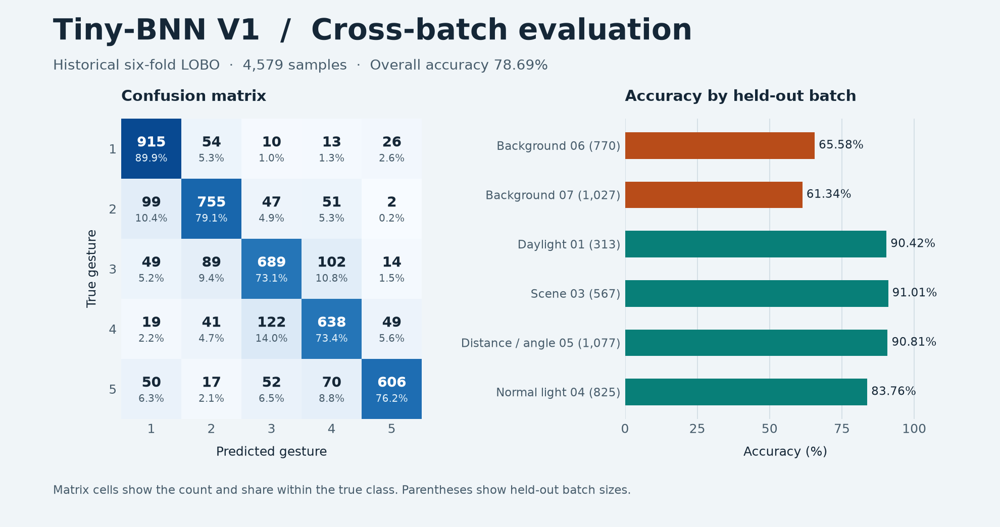

# FPGA Tiny-BNN

可复现的 FPGA 二值手势识别与软硬件一致性验证工程。包含 NumPy 训练、4567 张已清洗二值样本、冻结 V1 权重、RTL 推理核、最大连通域与 ROI 归一化，以及 Python/RTL 对拍。

从双板视觉与仿生手比赛工程提取，开源范围从二值手部掩膜开始。摄像头、ISP、DDR、HDMI、以太网与舵机板级工程不属于此仓库。

```text
256×144 binary mask
  → largest 8-connected component (31 recyclable labels)
  → 10% margin / clipping / square padding / nearest 32×32
  → 1024 → 96 → 48 → 5 binary neural network
  → integer scores / gesture ID / score margin
```

## 手势识别结果



图中选五类手势各一个正确示例，并展示一个手势 5 被预测为手势 4 的案例。204 帧诊断样本中，模型预测与真实标签一致 97 帧（47.55%），RTL 与 Python 在全部 204 帧上逐项一致。 [样本与预测数据](testvectors/pipeline/vectors.json) · [RTL 对拍记录](https://github.com/Msuidvg/fpga-tiny-bnn/actions/runs/42954281044)

## 快速验证

需要 Python 3.11 或更新版本。命令均在仓库根目录执行：

```sh
python -m pip install -r requirements.txt
python -m tools.bnn.demo --vector 0 --preview build/demo.png
python scripts/run_checks.py
```

单图命令输出包围框、类别、五类整数分数和分数差，并保存带 32×32 ROI 的预览。也可以用 `--mask hand.png` 输入自己的 `256×144` 单通道二值掩膜，前景为白色。样本 0 的类别为 `1`，分数为 `[23, -16, -1, 2, 3]`。

完整 RTL 对拍另需 PATH 中有 `iverilog` 和 `vvp`：

```sh
python scripts/run_checks.py --rtl
```

日志和新结果写入 `build/`。GitHub Actions 在 Ubuntu 上运行相同命令，覆盖 48 组核心向量与 204 组 CCL、归一化及完整管线向量。无需开发板和厂商工具即可运行仿真。

## PH1P35 上板示例

示例在 PH1P35MDG324 上以 50 MHz 构建，分别提供分类核回放和 `256×144` 掩膜完整管线回放。按 K3 复位后，FPGA 从 ROM 循环读取三个固定样本，经 UART 输出类别、五类分数和周期计数。两个构建已通过布线后静态时序检查，UART 数据包已通过 RTL 仿真。物理板卡验收待执行。 [接线、构建和性能表](examples/ph1p35/README.md) · [v0.2.0 位流与源码包](https://github.com/Msuidvg/fpga-tiny-bnn/releases/tag/v0.2.0)

## 实现要点

- 推理核每拍执行一个二值乘法，使用 XNOR 匹配计数、整数阈值及有符号输出偏置。
- 权重以 32-bit 分块同步预取，面向块 RAM 推断；V1 逻辑权重共 103152 bit（12894 byte），物理 RAM 占用需由目标器件综合确认。
- CCL 只保存一行标签，回收已结束连通域的标签，并利用相邻采样间隔分阶段合并。
- ROI 归一化与 Python 统一采用 ties-to-even 舍入、边界裁剪、方形补零及最近邻缩放。
- 隐藏层宽度可配置；输入 1024 bit、输出五类及内部计数器宽度仍有固定限制，详见接口文档。

## 指标与边界

| 项目 | V1 结果及含义 |
|---|---|
| 随附数据 | 六个独立采集批次，共 4567 张 32×32 二值掩膜；从历史 4579 张中排除 12 张误采样本 |
| 六折 LOBO | 汇总准确率 78.69%，宏平均召回率 78.35%；历史跨批评估 |
| 全量部署模型拟合 | 96.09%，使用参与训练的数据复算 |
| Python 整数实现 | 历史 4579 张一致；本仓库重新在清洗后的 4567 张上逐层验证 |
| RTL 核历史对拍 | 48/48，包含 20 个模型误分类难例 |
| 完整管线历史对拍 | 204/204，比较归一化图像、分数、类别与置信差 |
| V1 核延迟 | 103153 个时钟；75 MHz 下理论约 1.38 ms，仅指分类核 |

78.69% 和 96.09% 均对应历史 4579 张数据。V1 保留原冻结权重，清洗集用于重训和整数对拍。204 组 parity 数据来自碎裂轮廓诊断采集，该批模型准确率为 47.55%。另复算了 708 张独立归一化掩膜及 606 张单类诊断掩膜。 [留出评估及采集范围](docs/EVALUATION.md)

冻结模型 SHA-256：`12dd5fe1e6ae5402d0b08fe530f0a2937a59587bb6daebd8943f709c1d3c6717`。

### V1 跨批评估



图中汇总了历史 4579 张样本的六折留一批次评估。混淆矩阵显示样本数和真实类别内占比，右图给出每个留出批次的准确率。 [V1 评估数据](reports/training_v1.json)

## 训练与导出

```sh
python -m tools.bnn.train_bnn --summary-only
python -m tools.bnn.train_bnn --epochs 240 --seed 20260930 --model build/model.npz --report build/training.json
python -m tools.bnn.export_bnn_fpga --model models/v1/model.npz --output-dir build/fpga
python -m tools.bnn.export_bnn_eram32 --help
```

训练命令重新执行六折 LOBO 和全量训练，耗时随 CPU/BLAS 而变化。正式 V1 的原始种子和配置以 `reports/training_v1.json` 为准；重新训练结果不承诺与历史文件逐字节相同。新模型默认写入 `build/`，保留冻结模型。

## 目录

| 路径 | 内容 |
|---|---|
| `rtl/` | 四个主要模块及推断 RAM 子模块 |
| `sim/` | 四组自动检查 testbench |
| `tools/bnn/` | 训练、整数参考、导出与单元测试 |
| `models/v1/` | 冻结模型及 FPGA 内存文件 |
| `data/` | 清洗后的二值数据与批次统计 |
| `testvectors/` | 核心及完整管线对拍输入和期望值 |
| `examples/ph1p35/` | TD 构建、UART 回放 RTL、约束及实板验收命令 |
| `docs/` | [接口](docs/INTERFACES.md)、[验证](docs/VERIFICATION.md)、[来源](docs/PROVENANCE.md) |

代码、随附模型与二值数据按 [MIT](LICENSE) 许可提供。NumPy、OpenCV、Icarus Verilog 为独立依赖，遵循各自许可证；仓库未包含厂商专有 IP。
